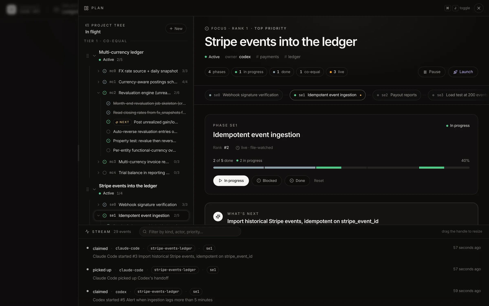
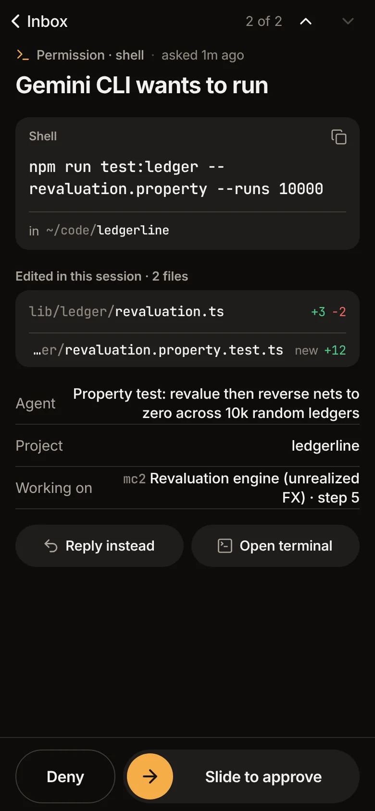
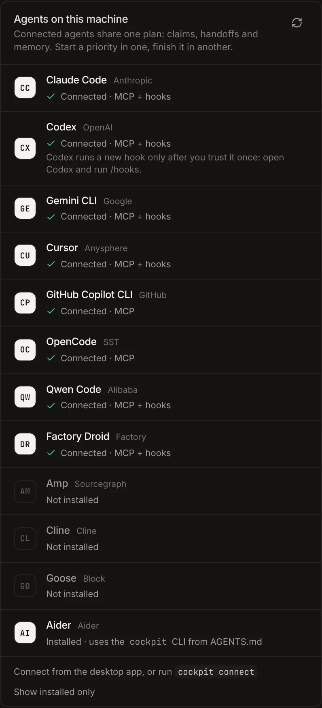

# Cockpit

One plan and one inbox for every coding agent you run.

Cockpit is a desktop app for people who work with coding agents. Agents in any of 12 harnesses (Claude Code, Codex, Gemini CLI, Cursor, GitHub Copilot CLI, OpenCode, Qwen Code, Factory Droid, Amp, Cline, Goose and Aider) work from one plan that lives as Markdown in your repo. They claim a step before they start, hand off with notes when they stop, and share what they learned. When one needs you, its question, plan approval or permission prompt lands in one inbox, on the desktop or on your phone.

## Download

**[Cockpit for Windows](https://github.com/fadhelcarlos/cockpit-desktop/releases/latest/download/Cockpit-Setup.exe)** · Windows 10 and 11, x64 · [all releases](https://github.com/fadhelcarlos/cockpit-desktop/releases)

The installer is not code-signed yet, so on first run Windows SmartScreen asks once: choose **More info**, then **Run anyway**. Cockpit installs for all users (one administrator prompt) and updates itself from inside the app.

## What it does

- **One plan for every agent.** Priorities, phases and steps in Markdown inside your repo, versioned with your code. Agents read and update it through an MCP server or the `cockpit` CLI.
- **No two agents on the same step.** An agent claims a step under a lease before it works. The next agent sees the claim and takes other work, or picks up the handoff, with its notes, when the step is released.
- **One inbox.** Questions, plan approvals and permission prompts from every session, each showing the command or file change it asks about. Answer them without switching terminals.
- **Launch from the plan.** Start any installed agent on a step in a built-in terminal; its first message is typed for you. With "Ask before tools", the agent asks before each tool, whatever its own defaults say.
- **On your phone.** Pair over Tailscale with a QR code. Answer prompts with Slide to approve, follow live terminals and replays, start an agent, edit the plan. Every paired phone has its own token, and the app can be locked with a passcode.
- **It wires itself.** Cockpit finds the agents installed on your machine and connects their hooks and MCP in each one's own format, with its own runtime: no Node.js to install.

  
  &nbsp;&nbsp;
  

## Requirements

- Windows 10 or 11, x64
- At least one supported coding agent, installed and signed in
- [Tailscale](https://tailscale.com), only for the phone app

## About this repository

It hosts Cockpit's installers and the feed the app updates from. The app's source is private.

Built by [Carlos Fadhel](https://checkboxlabs.my/carlosfadhel).
